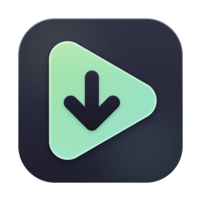
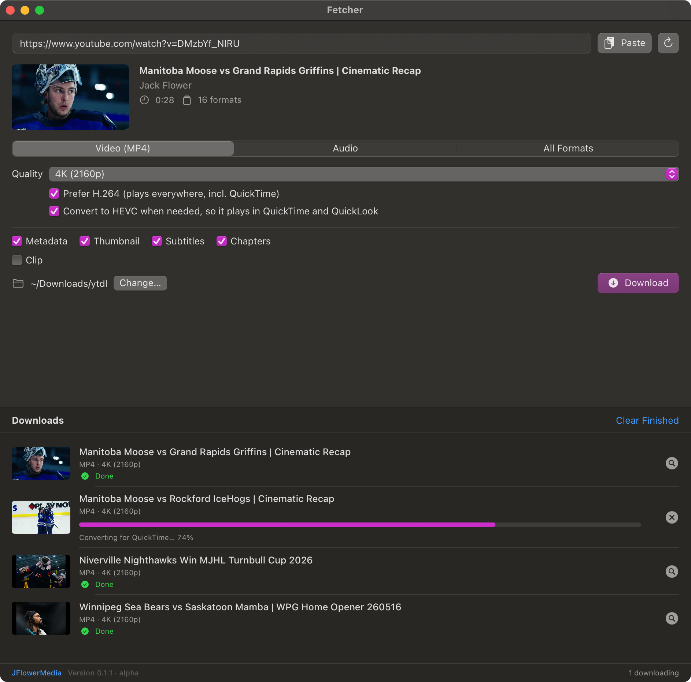

<div align="center">



# Fetcher

**Paste a link, get the file.**

A native Mac app for [yt-dlp](https://github.com/yt-dlp/yt-dlp). Video that plays in QuickTime, audio,<br>
or any format a site offers, without remembering a single flag.

[](../../releases)


**[Download](../../releases)** &nbsp;·&nbsp; **[Guide](#guide)** &nbsp;·&nbsp; **[Report a problem](../../issues)**

</div>

<p align="center"></p>

| 1. Paste | 2. Choose | 3. Download | 4. Play |
|:--|:--|:--|:--|
| Paste or drop one link, or several. | Video, audio, or any stream on offer. | Up to three run at a time. | 4K is converted so QuickTime can open it. |

> [!NOTE]
> Alpha, version 0.1.2. Tested on one Mac with YouTube.

## What it does

- **Video as MP4**, from Best down to 360p. H.264 and AAC are preferred, so files play everywhere.
- **4K that plays.** Above 1080p YouTube only offers VP9 or AV1, so Fetcher re-encodes to HEVC with the Mac's hardware encoder.
- **Audio** as MP3 at the bitrate you choose, M4A, Opus, FLAC, WAV or the original stream, with cover art and metadata.
- **Clips.** Download 1:20 to 2:45 instead of the whole video.
- **Many links at once**, and whole playlists, all with the same settings.
- **Subtitles and chapters**, embedded in the file.
- **yt-dlp kept current.** Old versions stop working, so Fetcher warns you after 60 days and updates it in one click.

## Install

Download the latest **Fetcher** zip from [Releases](../../releases), unzip it, and drag **Fetcher.app** to Applications.

Fetcher isn't notarized by Apple, so macOS blocks the first launch:

1. Open Fetcher and click **Done** on the warning.
2. Go to **System Settings → Privacy & Security** and click **Open Anyway** beside Fetcher.
3. Open Fetcher again and click **Open**.

On first launch Fetcher downloads whichever of yt-dlp, ffmpeg and deno you don't already have, about 150 MB, and checks each one against its checksum. They go in your own Library folder, so there's no Homebrew, no Terminal and no password. (yt-dlp needs deno to get past YouTube's JavaScript checks.)

Fetcher needs a Mac with Apple Silicon.

<details>
<summary>Or use Terminal, or build it yourself</summary>

Allow it in one line:

```
xattr -dr com.apple.quarantine /Applications/Fetcher.app
```

Build from source (needs Xcode's command line tools).

```
git clone https://github.com/jflowermedia/fetcher.git
cd fetcher
./build.sh --install
```

</details>

## Guide

**Get a video.** Copy a link and switch to Fetcher, which fills it in for you. Pick a quality and click **Download**. To stop links filling themselves in, turn off **Edit → Fill In Copied Links Automatically**.

| Keys | What it does |
|:--|:--|
| <kbd>⇧⌘V</kbd> | Pastes a link from the clipboard. |
| <kbd>Return</kbd> | Fetches the link's info. |
| <kbd>⌘Return</kbd> | Downloads it. |

**Choose the exact stream.** **All Formats** is a sortable table of everything on offer. Pick a video-only stream and the best audio is merged in. Keep the original, remux it to MP4 or MKV, or re-encode it to MP4.

**Cut a clip.** Tick **Clip** and type the start and end. **Precise cuts** re-encodes at the cut points, so the clip starts exactly where you asked.

**If something goes wrong.**

| Problem | Try this |
|:--|:--|
| Downloads suddenly fail | Choose **Fetcher → Update yt-dlp**. Site changes break old versions. |
| One download failed | Click the log button on its row. It shows the exact yt-dlp command, so you can run it in Terminal yourself. |
| yt-dlp, ffmpeg or deno isn't found | Click **Install** at the top of the window. Fetcher looks in `/opt/homebrew/bin`, `/usr/local/bin` and `~/.local/bin`, then uses its own copies in `~/Library/Application Support/Fetcher`. |
| 4K won't play in QuickTime | Leave **Convert to HEVC when needed** on, as it is by default. A 4K minute takes roughly 20 seconds on an M1 Max. |

**Not there yet.** You can't change the filename template, the number of parallel downloads or the speed limit, and the downloads list is cleared when you quit.

## Credits

Built by **JFlowerMedia** · [jflowermedia.com](https://jflowermedia.com/) · [@jflowermedia](https://www.instagram.com/jflowermedia/)

All the downloading is done by [yt-dlp](https://github.com/yt-dlp/yt-dlp) and [FFmpeg](https://ffmpeg.org/). Fetcher is a front end for them. Its own copy of FFmpeg is [Martin Riedl's build](https://ffmpeg.martin-riedl.de/).

The icon uses the [Catppuccin](https://github.com/catppuccin/catppuccin) palette, MIT. Fetcher is [MIT licensed](LICENSE).

<details>
<summary>Disclaimer</summary>

Fetcher is alpha software, provided as is, without warranty. Only download content you have the right to download, and respect each site's terms of service and the creator's copyright. No liability is accepted for how it's used.

</details>
